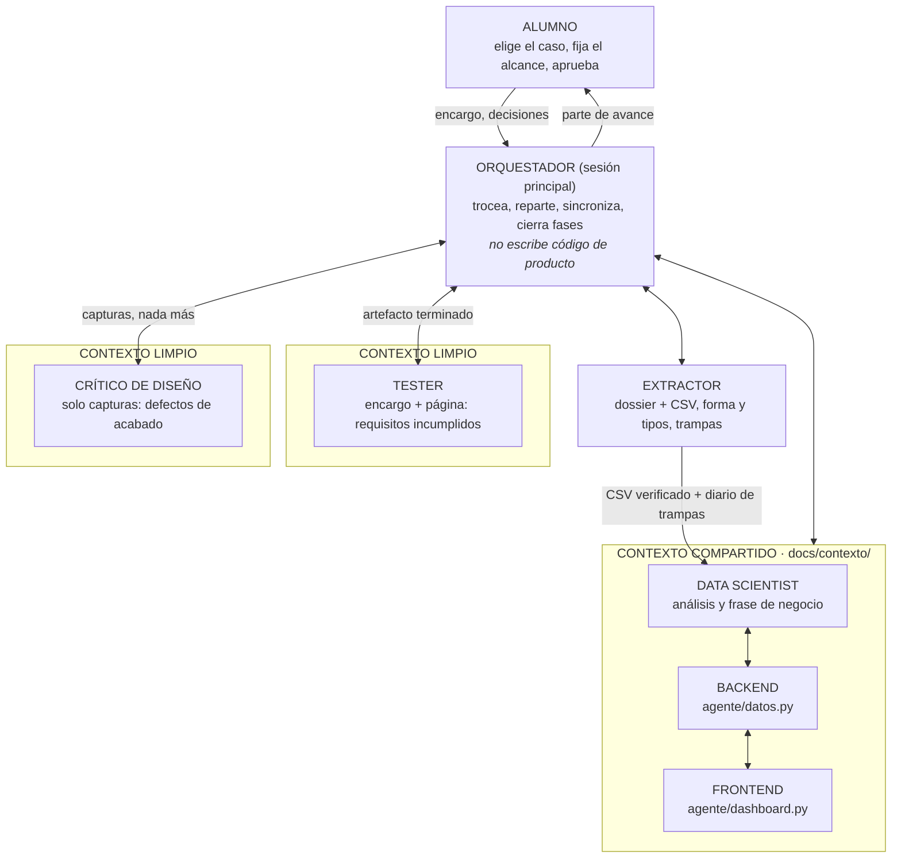

# proyecto-deep-agente

Agente de IA que **convierte un conjunto de datos (CSV) en un dashboard interactivo**. El agente:

1. **Perfila** el dataset: tipos de columna, ausencias, estadísticos y categorías.
2. **Diagnostica la calidad del dato**: categorías escritas de varias formas, valores centinela (`-99`), valores imposibles, textos que significan "sin dato" (`N/D`), fechas guardadas como texto y duplicados.
3. **Decide y aplica la limpieza**, justificando cada operación.
4. **Consulta agregados** (conteos, medias y tasas) para responder las preguntas de negocio. No inventa cifras: cada hallazgo sale de una consulta.
5. **Diseña el dashboard**: KPI, filtros, gráficos y hallazgos. El resultado es un único archivo HTML que se abre en cualquier navegador.

El agente usa Claude (`claude-opus-5-5`) con *tool use*. Las herramientas son funciones deterministas en pandas, así que el modelo decide **qué** hacer y el código lo **calcula**.

## Arquitectura de siete agentes

El proyecto se trabaja con un equipo de agentes de Claude Code (ver `CLAUDE.md` y `.claude/agents/`):



| Agente | Ficha | Contexto |
|---|---|---|
| Orquestador | `CLAUDE.md` | todo |
| Extractor | `.claude/agents/extractor.md` | compartido |
| Data scientist | `.claude/agents/data-scientist.md` | compartido |
| Backend | `.claude/agents/backend.md` | compartido |
| Frontend | `.claude/agents/frontend.md` | compartido |
| Tester | `.claude/agents/tester.md` | limpio: encargo + página + CSV |
| Crítico de diseño | `.claude/agents/critico-diseno.md` | limpio: solo capturas |

El contexto compartido está en `docs/contexto/`: el encargo (`encargo.md`), el contrato de archivos y JSON (`contrato.md`), el diario de trampas (`diario_trampas.md`) y el análisis (`analisis.md`).

**Cómo usarlo:** abre Claude Code en la carpeta del proyecto y pídele, por ejemplo, *"Haz la fase de verificación"* o *"Nuevo caso: este CSV y este dossier"*. La sesión actúa de orquestador y llama a cada agente con su ficha. Para las capturas del crítico: `pip install -r requirements-dev.txt && python -m playwright install chromium`, y después `python scripts/capturas.py web/index.html`.

## Estructura

```
agente/
  datos.py        # carga, perfil, detección de problemas, limpieza y consultas (pandas)
  dashboard.py    # genera el HTML interactivo (Plotly.js) a partir de una especificación
  agente.py       # el agente: Claude + herramientas (perfilar, detectar, limpiar, consultar, crear_dashboard)
  automatico.py   # modo sin IA: misma limpieza y un diseño genérico por reglas
  __main__.py     # línea de comandos
datos/            # dataset de ejemplo: accidentes de tráfico urbanos + su ficha (PDF)
ejemplos/         # plan de ejemplo (limpieza + dashboard) para el dataset de accidentes
web/index.html    # dashboard de ejemplo ya generado, para verlo en el navegador
tests/            # tests (python -m unittest)
.claude/agents/   # fichas de los seis agentes (el orquestador es la sesión principal, ver CLAUDE.md)
docs/contexto/    # contexto compartido: encargo, contrato, diario de trampas y análisis
scripts/          # capturas.py: capturas de la página para el crítico de diseño
```

## Instalación

Requiere Python 3.10 o superior.

```bash
python -m venv .venv && source .venv/bin/activate
pip install -r requirements.txt
cp .env.example .env   # y pon tu ANTHROPIC_API_KEY
export ANTHROPIC_API_KEY=...   # o cárgala desde .env
```

## Uso

**Con el agente de IA**, pasándole también la ficha del dataset para que entienda el contexto de negocio:

```bash
python -m agente datos/accidentes_urbanos.csv \
  --contexto datos/ficha_accidentes_urbanos.pdf \
  --objetivo "Decidir si invertir en velocidad, en protección del usuario vulnerable, en intersecciones o en el entorno" \
  --salida salida/dashboard.html
```

Verás en la terminal qué herramientas va usando. Al terminar genera dos archivos:
- `salida/dashboard.html`: el dashboard.
- `salida/dashboard.plan.json`: el plan que decidió el agente (limpieza + diseño). Con él se puede regenerar exactamente el mismo dashboard sin volver a llamar a la IA.

**Desde un plan ya hecho** (sin IA y sin coste):

```bash
python -m agente datos/accidentes_urbanos.csv --spec ejemplos/accidentes_plan.json --salida salida/accidentes.html
```

**Modo automático** (sin IA: limpieza y diseño por reglas fijas, sin hallazgos):

```bash
python -m agente datos/accidentes_urbanos.csv --sin-ia
```

Si no hay `ANTHROPIC_API_KEY`, el programa usa el modo automático. Si el agente no llega a crear el dashboard, también.

## El dashboard

- **Filtros** (chips para categorías, rangos para números y fechas) que actualizan a la vez todos los KPI y gráficos.
- **Tipos de gráfico**: `barras`, `tasa` (% de casos que cumplen una condición, por ejemplo "con heridos"), `histograma`, `linea_tiempo` y `calor`. Todos admiten desglose por color y tramos numéricos.
- **Hallazgos** redactados por el agente.
- **Panel de calidad del dato**: qué problemas se encontraron y qué se hizo con cada uno.
- Modo claro y oscuro, adaptado al móvil. Plotly.js se carga desde cdnjs, así que hace falta conexión.

## Ejemplo: accidentes de tráfico urbanos

`datos/accidentes_urbanos.csv` tiene 9.200 accidentes y 16 campos, con problemas de calidad a propósito:
- `tipo_accidente`: 18 variantes para 5 tipos.
- `velocidad_estimada_kmh = -99` en 518 registros.
- Edades de hasta 54.000 años y visibilidades de hasta 143.000 m.
- `con_lesiones` escrito como "si" en lugar de "sí".
- `alumbrado = "N/D"`.

`ejemplos/accidentes_plan.json` es un plan de referencia escrito a mano con las mismas herramientas que usa el agente. Sirve para comparar con lo que propone el agente.

## Ver la web en local

`web/index.html` es el dashboard de ejemplo ya generado. Para verlo en el navegador:

```bash
cd web
python -m http.server 8000
```

y abre http://localhost:8000. Para regenerarlo (con el plan de ejemplo o con el agente de IA):

```bash
python -m agente datos/accidentes_urbanos.csv --spec ejemplos/accidentes_plan.json --salida web/index.html
python -m agente datos/accidentes_urbanos.csv --contexto datos/ficha_accidentes_urbanos.pdf --salida web/index.html
```

## Tests

```bash
python -m unittest -v
```

## Cómo adaptarlo a otro dataset

No hay nada específico del dataset de accidentes en el código: basta con pasar otro CSV. Si hay documentación del dataset (PDF o texto), pásala con `--contexto` y usa `--objetivo` para decir qué decisión quieres tomar con el dashboard.
